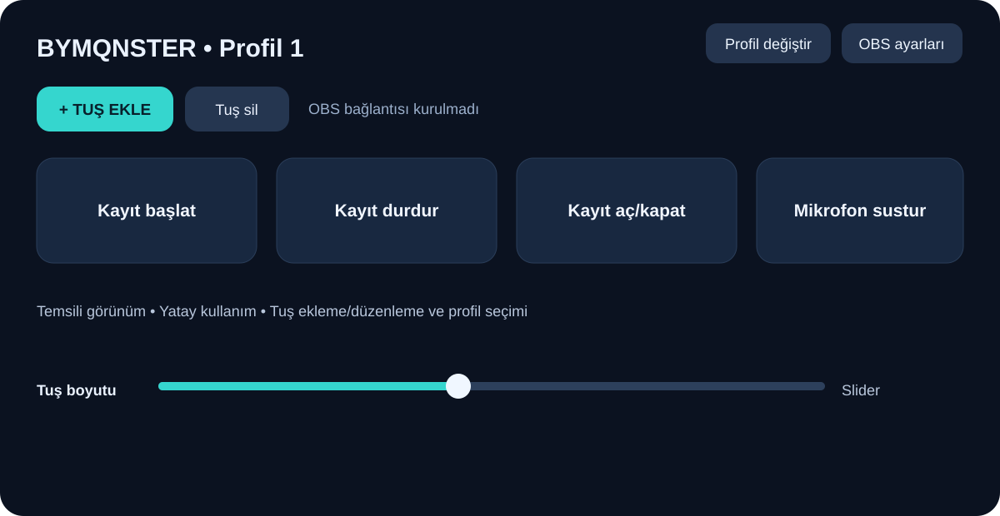
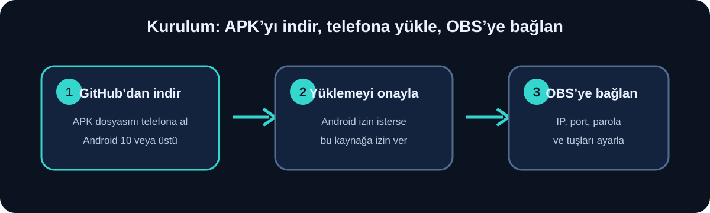
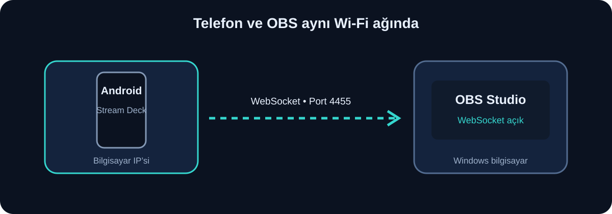

# BYMQNSTER Stream Deck

Android telefonunu yatay dokunmatik kumanda olarak kullanıp OBS Studio’ya Wi‑Fi üzerinden komut gönderen bir uygulama.

> **İndir:** [BYMQNSTER Stream Deck v1.0 Wi‑Fi APK](distribution/BYMQNSTER-StreamDeck-v1.0-wifi-debug.apk)  
> Uygulama Android 10 (API 29) ve üzerini gerektirir. Bu APK Android Studio debug anahtarıyla imzalanmıştır; Google Play sürümü değildir.

## Uygulama görünümü

## Kurulum

1. Yukarıdaki APK bağlantısını telefonda açıp dosyayı indir.
2. İndirilen APK’ya dokun. Android, tarayıcıdan yükleme izni isterse yalnızca bu yükleme için izin ver ve **Yükle**’ye bas.
3. Uygulamayı aç. APK GitHub’dan gelmelidir; mesajlaşma gruplarından gelen APK’ları yükleme.

## OBS ve Wi‑Fi bağlantısı

OBS WebSocket, OBS Studio 28 ve sonrasında yerleşik gelir. OBS’de **Tools → obs-websocket Settings** bölümünden sunucuyu etkinleştir. Port olarak `4455` kullan; parola doğrulamasını açık tut ve bir WebSocket parolası belirle. [OBS uzaktan kontrol rehberi](https://obsproject.com/kb/remote-control-guide)

1. Telefon ve bilgisayar aynı Wi‑Fi ağına bağlı olsun.
2. Windows’ta Komut İstemi’ni açıp `ipconfig` çalıştır. Wi‑Fi adaptörünün **IPv4 Address** değerini bul (örneğin `192.168.1.25`). `127.0.0.1` yazma; bu telefonun kendisini gösterir.
3. Uygulamada **OBS ayarları**’na dokun. Bilgisayarın IPv4 adresini, OBS portunu (`4455`) ve OBS’de belirlediğin WebSocket parolasını gir.
4. **Bağlan**’a bas. Durum alanında OBS bağlantısının açıldığını görmelisin.
5. Bağlanmazsa OBS’de WebSocket sunucusunun açık olduğunu, IP/port/parolanın doğru olduğunu ve Windows Güvenlik Duvarı’nın OBS’ye özel ağda izin verdiğini kontrol et.

**Bu sürüm Wi‑Fi kullanır; USB/ADB bağlantı seçeneği kaldırılmıştır.** WebSocket parolanı paylaşma. Her kullanıcı kendi OBS bilgisayarındaki parolayı uygulamaya girmelidir.

## Tuşları kullanma

- Ana ekrandan **+ TUŞ EKLE**’ye dokun, bir ad gir ve işlemi seç.
- Desteklenen işlemler: kaydı başlat, kaydı durdur, kaydı aç/kapat, sahne değiştir, mikrofonu sustur ve mikrofonun sesini aç.
- Sahne veya mikrofon işlemi seçtiğinde **OBS listesini göster** düğmesine dokunup OBS’deki adı seç. Gerekirse adı elle de yazabilirsin.
- Kaydet ve ana ekrandaki tuşa dokun. Bir tuşu basılı tutarak düzenleyebilir, sıralayabilir veya silebilirsin.
- Tuş boyutu kaydırıcısıyla ana ekrandaki tuşların yüksekliğini ayarla.
- **Profil değiştir** ile üç profil arasında geçiş yap. **Tuş sil** penceresi tüm profillerdeki tuşları listeler.

## Sınırlamalar

Bu sürüm yayın başlatma/durdurma, kamera kaynağını kapatma veya telefonu kilitleme işlemlerini içermez. Bağlantı ve OBS sahne/kaynak adları bilgisayardaki OBS kurulumuna bağlıdır; ilk kullanımdan önce her tuşu deneme sahnesinde kontrol et.

## Geliştirme

Android Studio’da projeyi açıp `app` modülünü çalıştır. APK üretmek için **Build → Generate APKs** seçeneğini kullan. Kaynak kod Kotlin, Jetpack Compose ve OBS WebSocket 5 kullanır.